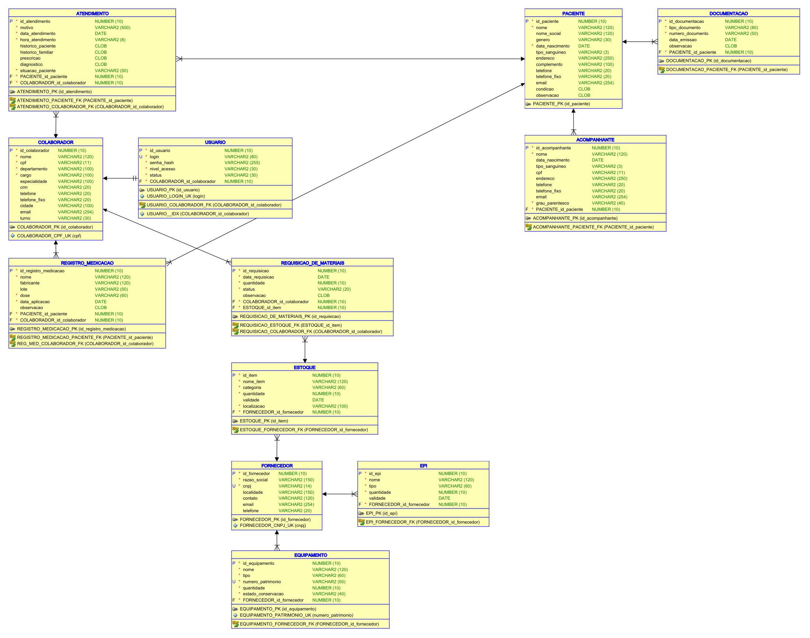

# Hospital Infantil · Modelagem de Banco de Dados

Projeto acadêmico de banco de dados relacional para centralizar informações de um hospital infantil: pacientes, acompanhantes, atendimentos, profissionais e recursos hospitalares.

Desenvolvido no contexto do curso de **Análise e Desenvolvimento de Sistemas**, com **Oracle SQL Developer Data Modeler 24.3.1** e DDL gerado para **Oracle Database 11g**.

**Escopo desta versão:** modelagem, script de criação e documentação técnica. O repositório representa a base de dados de uma proposta de sistema de gestão hospitalar.

## Visão do modelo



[Conceitual em PDF](docs/diagramas/modelo-conceitual.pdf) · [Lógico em PDF](docs/diagramas/modelo-logico.pdf) · [Físico em PDF](docs/diagramas/modelo-fisico.pdf)

## O que o projeto organiza

| Área | Entidades |
|---|---|
| Cadastro e acompanhamento | `PACIENTE`, `ACOMPANHANTE`, `DOCUMENTACAO` |
| Atendimento clínico | `ATENDIMENTO`, `REGISTRO_MEDICACAO` |
| Equipe e contas de acesso | `COLABORADOR`, `USUARIO` |
| Recursos e abastecimento | `FORNECEDOR`, `ESTOQUE`, `EPI`, `EQUIPAMENTO`, `REQUISICAO_DE_MATERIAIS` |

A proposta centraliza os registros e define vínculos consistentes entre eles. Cada atendimento identifica seu paciente e colaborador; cada requisição identifica o solicitante e o item; cada conta de usuário pertence a um colaborador.

## Regras presentes no DDL

| Elemento | Quantidade |
|---|---:|
| Tabelas | 12 |
| Chaves primárias simples | 12 |
| Chaves estrangeiras | 12 |
| Colunas `NOT NULL` | 62 |
| Constraints `UNIQUE` | 3 |
| Índices únicos explícitos | 2 |
| Constraints `CHECK` | 4 |

- CPF do colaborador, CNPJ do fornecedor, login e número de patrimônio têm regras de unicidade.
- Um colaborador pode ter **zero ou uma conta**; cada conta exige exatamente um colaborador.
- As quantidades de estoque, EPI e equipamento não podem ser negativas.
- A quantidade de uma requisição deve ser maior que zero.
- Cada tabela tem seu identificador próprio; as FKs ficam separadas das PKs.

## Documentação

- [Contexto, decisões e relacionamentos](docs/modelagem.md)
- [Dicionário completo de dados](docs/dicionario-dados.md)
- [Segurança, LGPD e contexto de IA](docs/seguranca-privacidade.md)
- [Como executar e consultar](docs/execucao.md)
- [Resultado e limites da validação](docs/validacao.md)
- [Como publicar este projeto no GitHub](docs/publicacao-github.md)
- [Projeto editável do Data Modeler](modelos/README.md)

## Como explorar

Os PDFs e a documentação podem ser consultados sem uma conexão com banco de dados.

Para revisar o DDL localmente, com Python 3:

```bash
python scripts/validar_ddl.py
```

Para criar as tabelas em um ambiente Oracle, siga o [guia de execução](docs/execucao.md). A pasta `sql/` contém o schema, consultas ilustrativas e consultas para verificar a estrutura criada.

## Competências demonstradas

Modelagem de entidades e relacionamentos, cardinalidades, PKs e FKs, integridade referencial, tipos Oracle, constraints, geração de DDL e documentação das decisões de projeto e proteção de dados.

## Estado e evolução

A **validação estática do DDL passou**. A execução em uma instância Oracle ainda não foi realizada nesta revisão. O repositório não contém dados de pacientes, credenciais, aplicação web ou implementação de autenticação.

Próximas etapas: validar a criação em Oracle, incluir dados inteiramente fictícios para demonstração, desenvolver a aplicação e implementar os controles de acesso documentados. Há detalhes de evolução do domínio em [Modelagem](docs/modelagem.md).

## Autoria e contexto acadêmico

Projeto acadêmico desenvolvido em equipe no curso de ADS. Este repositório reúne a modelagem e a documentação para apresentação no portfólio de **Pietro**.

## Referências

[Oracle Data Modeler 24.3](https://docs.oracle.com/en/database/oracle/sql-developer-data-modeler/24.3/dmdug/data-modeler-concepts-usage.html) · [Tipos Oracle](https://docs.oracle.com/en/database/oracle/oracle-database/19/sqlrf/Data-Types.html) · [LGPD](https://www.planalto.gov.br/ccivil_03/_ato2015-2018/2018/lei/l13709.htm)
